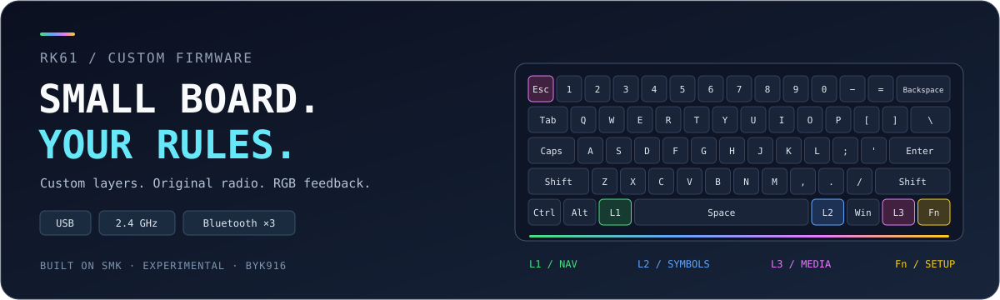

<p align="center">
  
</p>

<h1 align="center">RK61 Custom Firmware</h1>

<p align="center">
  <strong>Your keyboard. Your layers. No controller swap.</strong><br>
  A reverse-engineered SMK port for one Royal Kludge RK61 hardware revision.
</p>

<p align="center">
  
  
  
</p>

<p align="center">
  <a href="#features">Features</a> ·
  <a href="#layers">Layers</a> ·
  <a href="#build">Build</a> ·
  <a href="#flashing">Flashing</a> ·
  <a href="#documentation">Documentation</a>
</p>

---

A small keyboard shouldn't mean a fixed keymap. This project brings **Corne-inspired layers, useful lighting, and all three connection modes** to the RK61's original hardware—using [SMK](https://github.com/karstx/smk), not a replacement controller or a QMK port.

The port grew from a stock firmware dump, 8051 disassembly, and iterative tests on a real keyboard. The current **layout v5** has been flashed and reported working by the owner. It's a working personal port, **not universal RK61 firmware**.

> [!CAUTION]
> **RK61 keyboards come in different hardware revisions.** This port targets the board below. A matching product name or USB ID alone is not enough. Identify your hardware and preserve your own stock backup before considering a flash.

## Features

- **Three ways to type** — wired USB, the original 2.4 GHz dongle, and three Bluetooth slots.
- **Layers that feel familiar** — numbers, HJKL navigation, symbols, media controls, and Print Screen, inspired by a daily-driver Corne layout.
- **Lighting with a purpose** — whole-keyboard layer colours and an Esc key that shows the selected output mode.
- **Your colours, your brightness** — nine base colours, brightness controls, and no lighting animation getting in the way.
- **Original wireless hardware** — explicit, slot-specific Bluetooth pairing; no routine bond wipe or radio-firmware replacement.
- **Readable source** — physical-order keymaps, vendored SMK source, host-side regression tests, and preserved working images.

### The hardware this was built for

| Component | Target |
|---|---|
| Keyboard | Royal Kludge RK61, US ANSI layout |
| PCB | `130-81892-10 US`, dated `2022/08/16` |
| Controller marking | `BYK916`, supported here as SH68F90/SH68F90A-family 8051 |
| Keyboard USB ID | `258a:00e1` |
| Original dongle USB ID | `25a7:fa70` |

**Not QMK, VIA, or Vial.** Keymaps are compiled into the firmware; there is no live host-side remapping app.

## Layers

Keep the familiar base layout. Hold a layer key when you need more.

| Layer | Hold this physical position | What you get | Colour |
|---|---|---|---|
| Base | Nothing | Normal typing | Your selected colour |
| L1 | Former Left Alt | Numbers, H/J/K/L arrows, F1–F10 | 🟢 Green |
| L2 | Former Right Alt | Symbols, brackets, operators | 🔵 Blue |
| L3 | Former Right Ctrl | Volume, tracks, play/pause, Print Screen | 🟣 Magenta |
| Fn | Original Fn | Connection selection, F-keys, keyboard lighting | 🟡 Yellow |

```text
Ctrl │ Alt │ L1 │             Space             │ L2 │ Win │ L3 │ Fn
```

Unassigned keys on the user layers **do nothing**—they don't silently fall through to the base map. Layer priority is **Fn → L3 → L2 → L1**; releasing a layer restores the next held one.

→ **[See every key and edit the layout](KEYMAP.md)**

### Esc is your mode indicator

| Esc colour | Selected output |
|---|---|
| Teal | Bluetooth |
| Orange | 2.4 GHz dongle |
| Magenta | Wired USB |

This shows the **selected route**, not proof that a wireless host is connected. Esc keeps its mode colour across layers and stays at maximum brightness even when the main lighting is at zero.

### The shortcuts you'll actually use

| Shortcut | Action |
|---|---|
| **Fn + Q / W / E** | Select Bluetooth slot 1 / 2 / 3 |
| **Fn + P** | Pair the selected Bluetooth slot |
| **Fn + R / T** | Force dongle / wired output |
| **Fn + [ / ]** | Dim / brighten the main keyboard lighting |
| **Fn + .** | Cycle the normal colour; release Fn to see it |
| **L3 + Tab** | Main lighting off / restore |
| **L3 + Q / W** | Volume down / up |
| **L3 + H / J / K** | Previous track / next track / play-pause |
| **L3 + Y** | Print Screen |

The physical switches also select the route: normally, **power on follows the BT/dongle selector; power off with USB connected uses wired output**. A stable switch change takes over from a manual Fn selection. Preferences are currently RAM-only.

## Build

Run these commands from the repository root. `smk/` is included directly; no submodule setup is needed.

**Prerequisites on `PATH`:** SDCC (tested with 4.6.0, including `sdar` and `packihx`), Meson, Ninja, Python 3, a host C compiler, and [sinowisp](https://github.com/karstx/sinowisp). The local toolchain/install details are in the [developer handoff](docs/HANDOFF.md).

```sh
# Fresh build directory: debug console + ISP enabled, sleep disabled.
meson setup smk/build-rf-debug smk \
  --buildtype=debug -Disp=enabled -Dsleep=disabled

# Current all-mode target, including Bluetooth.
meson compile -C smk/build-rf-debug \
  royalkludge-rk61-rf-test_default_smk.hex

# Linked-image, routing, keymap/report, and LED-driver checks.
python3 test_bluetooth.py
python3 test_keymap.py
python3 -m unittest test_leds.LedDriverChecks -v
```

For an existing build directory, just run the compile command again. Despite its historical `rf-test` name, this is the current all-mode target—not the older wired-only prototype.

The working v5 checkpoint passed **45 regression tests across the development stages**, alongside SDCC builds and interrupt/overlay checks. Host tests check software behaviour; they do **not** prove electrical or over-air correctness.

## Flashing

> [!WARNING]
> **Experimental firmware can make a keyboard unusable.** Keep another keyboard and a USB cable available. A preserved bootloader does not guarantee recovery. Read the [recovery and flashing notes](docs/HANDOFF.md) first.

For the **verified hardware above**, a preserved, owner-tested application image is available in [`known-working/`](known-working/). Check its integrity:

```sh
(cd known-working && sha256sum -c layout-v5.SHA256SUMS)
```

Then, if you intend to flash that exact v5 image, run this yourself:

```sh
sudo "$(command -v sinowisp)" write \
  --platform sh68f90 --vendor_id 0x258a --product_id 0x00e1 \
  --format bin --reboot true \
  known-working/layout-v5.bin
```

**Do not use the old RK61 preset or generated Meson flash targets.** They do not identify this board correctly. Never pass a full 65,536-byte stock dump to an application-only write command.

Building new source does not update the preserved image above. Package each new experiment under a new filename; the [handoff](docs/HANDOFF.md) describes how. Never overwrite a tested recovery image.

### Still experimental

- **Sleep is disabled.** Switch the keyboard off when not using it; low-power/battery behaviour is unfinished.
- **Brightness is not an electrical rating.** Main lighting spans 0–256 PWM counts in steps of 16 and starts at 64. Esc always uses the 256-count maximum. Current and temperature limits have not been measured; stop if there is heat, flicker, or malfunction.
- **Wireless recovery needs more work.** Retries are bounded, and a lost release can leave a remote key held. Not every host, slot, rollover, or reconnection scenario has been tested.
- **No persistent preferences or battery warning yet.** Screenshot and display-brightness behaviour also depend on the host OS.

## Documentation

| Looking for… | Start here |
|---|---|
| Keymaps, colours, controls, and the hardware checklist | [KEYMAP.md](KEYMAP.md) |
| Detailed current handoff, provenance, build and recovery procedures | [Developer handoff](docs/HANDOFF.md) |
| Preserved application images, source snapshots and checksums | [known-working/](known-working/) |
| Matrix reconstruction | [Matrix table](matrix-table.md) · [Analysis](ANALYSIS.md) |
| Earlier reverse-engineering stages | [USB](PROTOTYPE.md) · [LEDs](LED-TEST.md) · [Dongle](WIRELESS-TEST.md) · [Bluetooth](BLUETOOTH-TEST.md) |
| What's tracked and what's kept local | [Version control](VERSION_CONTROL.md) |

Stage notes record the journey. The developer handoff is the detailed current reference. Raw stock dumps and stock-containing bundles are intentionally not distributed in this repository.

## Built on good work

- **[SMK](https://github.com/karstx/smk)** — the firmware foundation and 8051 support; its [GPLv2 license](smk/LICENSE) and upstream notices are retained in `smk/`.
- **[SDCC](https://sdcc.sourceforge.net/)** — the compiler making this port possible.
- **[sinowisp](https://github.com/karstx/sinowisp)** — firmware read/write tooling.
- **[Corne](https://github.com/foostan/crkbd)** — the inspiration for the layer workflow.

An independent, experimental project. Not affiliated with Royal Kludge.
